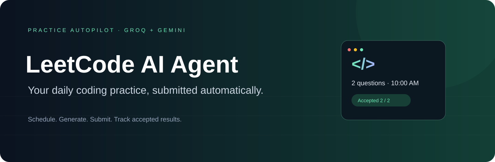
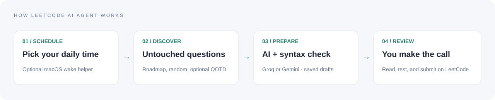
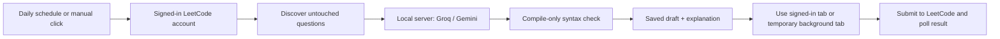

 <div align="center">



# LeetCode AI Agent ✨

**Build your coding habit. Let AI prepare the next practice session.**

[](https://nodejs.org/)
[](extension/manifest.json)
[](#ai-provider-setup)
[](LICENSE)

Scheduled LeetCode practice drafts · Manual batches · Review-first workflow · macOS wake scheduling

[Quick start](#quick-start) · [Features](#features) · [Troubleshooting](#troubleshooting) · [Contributing](CONTRIBUTING.md)

</div>

---

LeetCode AI Agent is a local AI practice assistant with a Brave/Chrome extension. Choose a time and a question count: it discovers untouched LeetCode problems, generates solutions with **Groq or Gemini**, checks syntax and LeetCode example test cases, submits passing drafts on the signed-in account, and records LeetCode's result.

For daily practice sessions, the extension generates a solution, runs a local syntax check and LeetCode Run Code against the question's examples, then submits only a passing draft on the currently signed-in browser account. If Run Code is unavailable, it blocks the judged submission and shows the reason. It makes at most two judged submissions per question per day; rejected code is regenerated once, and duplicate drafts never reach LeetCode. The dashboard reports first-submit accepted rate, Run Code failures, and provider outcomes for newly recorded attempts. The installed extension is named **Practice Ex.** Live rated contests send reminders and can be opened from the timetable. AI solving and submissions pause while an official contest is live; the contest is for the participant to solve without external code generation, as required by [LeetCode's contest rules](https://leetcode.com/discuss/post/951105/new-contest-rule-effective-from-december-2020/).

> **Project status: experimental.** This is an unpacked extension, not a Chrome Web Store release. LeetCode session APIs and provider model availability can change. Syntax checks do not prove solution correctness. Live API generation depends on your account access, quota, and provider uptime.

## How it works



The visuals above are illustrations of the workflow, not screenshots or evidence of successful submissions.



## Features

| Feature | What you get |
|---|---|
| ⏰ Daily scheduling | Your time and timezone; default 10:00 AM Asia/Kolkata |
| 🎯 Adjustable targets | Automatic daily count: 1–10; manual batch: 1–100 |
| 🧭 Problem discovery | Automatic LeetCode practice chooses QOTD plus a random untouched question; the owned sandbox follows a foundations-to-advanced roadmap |
| 📅 Daily QOTD slot | Automatic target cannot complete without an accepted QOTD; if discovery or solving fails, the hourly retry keeps the target open |
| 👤 Account flexibility | Uses whichever LeetCode account is signed in to the Brave/Chrome profile; daily runs and history stay account-specific |
| 🤖 Two AI providers | Groq and Gemini, editable model IDs, configurable fallback order |
| 📝 Draft history | Generated code, explanation, complexity, attempt counts, and failure feedback |
| 🔎 Syntax validation | Python compile-only parsing and JavaScript `node --check`; code is not executed |
| 🛑 Stop control | Cancels the preparation session and preserves already prepared drafts |
| 🗓️ Contest calendar | Next seven days, official start times, reminders, and a link to open each contest yourself |
| 🧹 Quiet browser tabs | Idle checks do not open LeetCode; a tab created for a scheduled or manual run closes when that run finishes |
| 🌙 macOS wake helper | Wake five minutes before practice or a listed contest; persistent background setup |
| 🔐 Local key storage | Provider keys encrypted on the server; extension stores the connection token |
| 💸 Budget controls | Daily token budget and up to eight generation attempts per question |
| 🧪 Owned test sandbox | Optional Docker judge and adapter for your own question/contest platform |
| ✍️ Owned-test solution style | Natural Hinglish explanation and readable code, or a concise style; applies only to the owned sandbox/test-platform agent |
| 📊 Detector evaluation | Measure an owned detector against labeled synthetic or consented code samples; reports confusion matrix and false-positive rate |

### Evaluate your own detector

Create a JSON file with labeled samples (`expected` is the known source, not the detector's guess):

```json
[
  {"id":"sample-1","expected":"human","code":"def solve(data):\n    return data"},
  {"id":"sample-2","expected":"ai","code":"def solve(data):\n    return list(reversed(data))"}
]
```

Your detector endpoint must accept `POST` JSON `{ "id": "...", "code": "..." }` and return `{ "score": 0.0 }`, where `1.0` means most likely AI. Then run:

```bash
npm run detector:eval -- --samples ./labeled.json --endpoint http://127.0.0.1:3011/detect
```

The report contains per-sample scores and aggregate accuracy, precision, recall, and false-positive rate; it does not print submitted source code. Set `DETECTOR_API_KEY` in the environment if your endpoint needs bearer authentication. This evaluator is for your own detector and does not interact with LeetCode contests.

The extension and macOS helper check LeetCode's official contest data about every 56 hours (roughly three times a week). The timetable keeps contests from the last seven days alongside the next seven days, so a contest remains visible after it ends. The helper caches successful results and preserves known wake events if LeetCode is temporarily unavailable. The rolling practice plan refreshes each Monday.

## Quick start

### 1. Get the project

Requirements:

- **Node.js 22+** and npm.
- **Brave or Chrome**, with LeetCode signed in.
- In **Settings & keys**, choose the same browser under **Browser for background wake**. The default is Chrome. Keep Practice Ex. installed in that browser profile.
- At least one working **Groq or Gemini API key** and a model available to your account.
- **Python 3** for Python draft syntax checking. JavaScript checks use Node.js.
- Docker only if you want the optional owned test sandbox; it is not required for live draft preparation.

```bash
git clone https://github.com/kvianAR/Code_Solver-ai-agent.git
cd Code_Solver-ai-agent
npm start
```

There are no npm dependencies to install. On macOS, double-click **Start Practice Ex.command**, or run `npm run setup`. The setup runs this checkout as a login service, chooses a free local port, and creates private pairing information for its unpacked extension. No administrator password is needed for this server-only setup.

For a temporary foreground server, `npm start` still works. The preferred port is 8787; if it is occupied, the agent selects a free port up to 8799. The address appears in the terminal and in local `data/server.json`.

Automatic pairing requires loading `extension/` from the same checkout whose server is running. The local server writes `extension/local-connection.json` with a private bootstrap key. It is not a web-accessible extension resource, is not served over HTTP, and is excluded from Git, Docker builds, and release archives. Do not copy this generated file into a shared extension package. Remote servers retain manual token setup under **Advanced**.

### 2. Load the extension

1. Open `brave://extensions` or `chrome://extensions`.
2. Enable **Developer mode**.
3. Select **Load unpacked** and choose this repository's `extension/` folder.
4. Open **Practice Ex.** from the browser toolbar.
5. The extension connects to its local agent automatically. If the server starts later, pairing retries each minute. **Connect automatically** retries immediately.
6. Keep LeetCode signed in in the same browser profile. Provider keys still need to be configured once.
7. After updating an existing unpacked extension, click **Reload** on its extension card, then reopen its dashboard. Its version and the server version appear in the setup checklist.

The localhost dashboard is useful for settings, but the **extension dashboard** is required for discovering account-specific questions. An automatic or manual run uses an existing LeetCode tab when available. If none is open, it creates a background tab for the run and closes that tab afterward. Clicking the extension icon alone does not open LeetCode.

### 3. Connect an AI provider

Open **Settings & keys**, enter the provider key and model ID, then select **Save** and **Test connection**.

### 4. Prepare a session

- **Current question:** open a `leetcode.com/problems/...` page, click the extension icon, then choose **Solve this question**. The compact popup shows today's progress, a seven-day chart, the current account, and a Stop button. This runs one manual session for that exact question, even if it was attempted before.
- **Full dashboard:** click **Open full dashboard** in the popup to manage the daily schedule, settings, and history.
- **Manual:** enter the number of questions and click **Prepare N now**.
- **Automatic:** set the start time, timezone, and questions/day; enable automatic mode and save. The extension uses whichever LeetCode account is signed in to that browser profile at run time.
- If an automatic run fails, fix the provider or login issue and click **Retry today’s drafts**. Earlier failed attempts remain in history.
- In Auto Mode, failed or interrupted daily work retries at the next hourly slot until the day's target is accepted. Accepted questions carry forward; the same run is never submitted twice concurrently. Completion cancels the remaining retry wake events after the wake helper refreshes.
- The automatic run attempts QOTD first. If QOTD cannot be accepted, it pauses the other daily questions and reports the reason. A temporary LeetCode Run Code rate limit or network failure retries at the next hourly slot; a permanent session or validation failure requires attention.
- The extension submits a solution only after local syntax checking and LeetCode Run Code examples pass on the account currently signed in to LeetCode. Passing examples reduce avoidable judged attempts but do not guarantee acceptance on hidden tests.
- A rejected solution is regenerated with judge feedback. When both configured providers are available, the next draft tries the other provider first. After two distinct judged submissions for the same question on the same day, automatic retries pause and the run asks for review. Archived copies of a submission do not consume extra slots. Repeated identical submitted drafts are never resubmitted.
- Daily result notifications show the accepted count and first failed question. Clicking one opens that exact run in Solution history. Groq and Gemini cards show the last known connection result and which provider handled the latest solution.

A successful connection test checks a small request. It does not guarantee a larger solution request will succeed.

## AI provider setup

| Provider | Key source | Default model in this repository |
|---|---|---|
| Groq | [Groq console](https://console.groq.com/keys) | `qwen/qwen3.8-27b` |
| Gemini | [Google AI Studio](https://aistudio.google.com/api-keys) | `gemini-3.6-flash` |

Model IDs are editable defaults, not a promise of access or uptime. Choose a model your account supports. Keys do not have a single fixed model attached to them: the application sends the selected model with each request.

Keys can also be supplied as environment variables:

```bash
export GROQ_API_KEY="your-groq-key"
export GEMINI_API_KEY="your-gemini-key"
npm start
```

A saved encrypted key takes priority over an environment variable. Deleting a saved key does not delete a key supplied through the environment.

## Scheduling and a sleeping Mac

**The extension needs its browser running and a signed-in LeetCode session in the same browser profile.** If a 10:00 run is missed, the wake helper schedules hourly wake events and the extension resumes on the next wake/poll. A Mac cannot execute browser code while it remains asleep, and closed-lid or battery behavior can prevent a scheduled wake.

The extension checks the LeetCode login shortly before the configured start and alerts if the session has expired. A signed-out account cannot receive accepted submissions; sign in again in the browser profile where Practice Ex. is installed. Once the account is visible, the next extension poll resumes a due daily run. A temporary LeetCode network/API failure is shown as **login check unavailable** rather than a false logout; the extension retries and never submits while login is unverified. The temporary tab used for the early login check is closed after the check. Chrome and Brave keep separate LeetCode sessions, so signing in to one does not sign in to the other.

For persistent local scheduling on macOS, run from the project folder:

```bash
npm run background:install
```

This installs the local server as a login service and the wake helper as a system service. macOS asks for your administrator password. Keep the browser with Practice Ex. open and your user logged in before sleep.

```bash
# Show service state and power events
npm run background:status

# Preview wake events without changing them
npm run wake:preview

# Stop/remove the background server and wake helper
npm run background:uninstall
```

The helper watches saved state changes and refreshes the daily wake schedule, hourly retry wakes, and contest wakes. For a **15:50** practice time, the first wake is **15:45**; if the target is incomplete, another wake is scheduled for **16:45**. The extension retries at the next hourly slot and carries forward already accepted questions, so a 1/2 run needs only one more acceptance. A missed first run starts on wake. The dashboard’s **Why didn’t it run?** panel shows the known reason and next retry time.

After updating the wake-helper code, run `npm run background:install` again so macOS uses it. This requires your administrator password. For an extension-only update, reload the unpacked extension in the browser where you use Practice Ex.; the wake helper does not need reinstalling.

For a sleep test, choose a time at least ten minutes ahead, save it, check status, and then put the Mac to sleep. Hardware, closed-lid behavior, battery state, and macOS may affect scheduled waking. This is not guaranteed powered-off execution.

Wake-only controls are also available:

```bash
npm run wake:install
npm run wake:uninstall
```

**Power-setting caveat:** the current helper uses macOS's shared repeating wake schedule. Installing it replaces that repeating wake schedule; uninstalling clears it. Do not use it alongside another tool that manages repeating power events without reviewing this behavior. Contest events have their own LeetCode AI Agent service identifiers.

A same-day stopped/failed automatic run can be archived and retried when moved to a later schedule. A completed session remains terminal for that account and date. Manual sessions have their own history entries.

## Settings

| Setting | Range / behavior |
|---|---|
| Start time | `HH:MM`, interpreted in the chosen IANA timezone |
| Questions/day | 1–10 drafts |
| Manual count | 1–100 drafts; actual availability depends on untouched eligible questions |
| Difficulties | Any combination of Easy, Medium, Hard |
| Daily QOTD | Required in automatic LeetCode practice, even if previously attempted; a QOTD accepted earlier today is credited instead of submitted twice |
| Max AI drafts | 1–8 per question; judged submissions are capped at 2 per question per day |
| Provider order | Groq → Gemini or Gemini → Groq |
| Token budget | 1,000–1,000,000 estimated/reported tokens per day |
| Language | Python or JavaScript |
| Account lock | Off by default; enable only if you want the configured username |

**Review mode:** enable “Prepare drafts for review” in Settings to generate syntax-checked, example-tested drafts without sending judged submissions. Copy the code and submit it yourself on LeetCode. These sessions show **review**, not **accepted**, and do not retry automatically while awaiting review.

**Retries:** select a 15–240 minute interval. Temporary provider/network errors pause generation until the next scheduled retry instead of immediately spending all draft attempts. Wrong solutions can still regenerate within the configured attempt and submission limits. The optional wake helper uses the selected interval after its next refresh; reinstall it after updating its code.

**Provider endpoints:** Groq defaults to `https://api.groq.com/openai/v1`. Set a local proxy URL explicitly if needed; for example, `http://127.0.0.1:3011/v1`. Use **Load available models** after saving a provider key to select models returned by that provider. A model being listed does not guarantee remaining generation quota.

**Recovery:** submission IDs are saved as soon as LeetCode returns them. After a browser restart, the extension checks saved IDs instead of generating duplicate submissions. **Check pending submission results** retries a failed result lookup. If the browser stopped before an ID could be saved, the run pauses for manual review of LeetCode history.

**Diagnostics and updates:** use the setup checklist or `npm run doctor` to check the server, syntax checker, provider connection status, and version. Provider connection tests remain explicit API calls. Run `npm run setup` after a server update and reload the unpacked extension after an extension update. `npm run setup:uninstall` removes only this checkout’s new server login service and preserves its data. The older combined `background:*` commands still manage the optional wake helper and their legacy service.

`config.json` contains installation defaults. Saved dashboard settings are preserved across restarts and code updates; changing defaults does not overwrite existing saved settings. To change an existing installation, use the dashboard.

## Troubleshooting

| Symptom | Check / fix |
|---|---|
| `No working Groq or Gemini API key` | Read provider cards and notifications for the actual quota, model, key, or connection error. Test a working key, then retry today’s drafts. Quota blocks are rechecked after 30 minutes or on the next local day. |
| Connection passes but drafts fail | Larger requests may hit a different quota or limit. Test an actual draft; inspect its feedback. |
| Gemini returns 404 | Check model access and ID for your account. A listed model may still reject generation. |
| Provider temporarily unavailable | Try later or configure the other provider. Retries are bounded. |
| Account changed during a run | The session stops to avoid mixing accounts. Sign in to the account you want, then retry today’s drafts or start a manual session. |
| Time saves but session does not start | Keep the local server and browser running. Check Auto Mode, today's run status, and the timezone. |
| `Could not update the daily schedule` | Reload the extension itself and reopen its dashboard; old background code can mismatch new dashboard code. |
| Old `Solve` button appears | Click the extension card's Reload button; reopen the toolbar dashboard. Current drafts use **Prepare**. |
| `Local syntax check unavailable` | Install Python 3 for Python drafts; ensure it is available to the background service. Review any unchecked draft carefully. |
| Wake schedule is wrong | Run `npm run background:status`; match the Mac and configured timezone. |
| `Failed to fetch` | Run the one-click setup, reload the extension, and use **Connect automatically**. Manual cloud setup still requires HTTPS and an allowed host permission. |
| `Agent connection unavailable` | Check `http://localhost:8787/health`, service status, server URL, and connection token. |
| Repeated `LOGIN` badge | Open LeetCode in the same Chrome/Brave profile as Practice Ex. and confirm your avatar appears. If it repeatedly signs out after a browser restart, check that this profile retains LeetCode cookies; avoid clearing LeetCode site data on exit. The extension cannot restore an expired LeetCode login itself. |
| `CHECK` badge or `login check unavailable` | LeetCode or the network did not answer the session check. Keep the browser online and let the next scheduled check retry; this does not mean the account was logged out. |

Updating an unpacked extension requires **Reload on its extension card**. Refreshing a dashboard tab alone does not reload the background worker. After an update, reopen existing LeetCode tabs so content scripts also refresh.

Current limitation: local syntax checks and LeetCode example runs cannot prove all hidden tests will pass. API service health must be checked using your own account; automated tests use mocked provider responses.

## Development

```bash
npm test
```

The automated suite covers schedule handling, history, provider fallback, LeetCode submission limits, account isolation, key encryption, budgets, HTTP authorization, stop behavior, settings persistence, and local syntax parsing. Automated tests do not make paid provider calls.

```text
leetcode-ai-agent/
├── extension/          # Manifest V3 dashboard, discovery, background worker
├── server/             # Local API, encrypted storage, providers, sandbox runner
├── scripts/            # Connection token and macOS install/status/wake helpers
├── test/               # Scheduling, provider, HTTP, draft and syntax checks
├── docs/assets/        # README visuals
├── config.json         # Fresh-install defaults
└── data/               # Runtime secrets and history (ignored by Git)
```

The browser extension sends practice submissions through the signed-in LeetCode session and polls the official judge result. The optional owned sandbox remains a separate workflow with a private judge. Read the [owned platform API guide](docs/platform-api.md) if you want to connect your own question system.

For the owned Docker sandbox:

```bash
docker pull python:3.12-alpine
docker pull node:22-alpine
docker compose up -d --build
```

Set `leetcode.enabled` to `false` to use that sandbox workflow. Its generated code executes in restricted containers. The Compose configuration mounts the Docker socket; use it only on a machine you control. The Docker server image does not include Python 3 for live draft syntax checks; add it before using that feature in Docker.

## Learning, budgets and adaptive practice

Open a LeetCode question, use **Learn with hints** in the popup, then continue in Learning mode. Hint, approach, review of your own code and full solution are separate explicit provider requests. They consume the same daily/session budgets as solution generation and never send judged submissions. Treat AI advice as fallible; code review does not claim to have executed your attempt.

With **Check generated boundary inputs** enabled, the generator can supply up to four small valid custom inputs. They are appended to the official example run and checked by LeetCode. The generator's guessed expected answers are not used. Missing or invalid cases are not evidence of correctness; all hidden tests still belong to the official judge. Starter-signature checks parse code without executing it.

Adaptive practice uses recorded AI-assisted outcomes per LeetCode account. It identifies topics with rejected submissions or example failures and schedules accepted questions for revision after 1, 3, 7, 14 and 30 days. Unresolved algorithm failures become due the next day. It selects at most one due revision alongside QOTD; the remaining selection prefers untouched questions. Archived task copies are deduplicated. These statistics do not measure the user's independent skill.

In **Practice and spending controls**, set session tokens/calls and optional daily estimated USD limits. Enter input/output USD prices per million tokens for your selected models. Changing a model or Groq endpoint clears its price estimate. Price fields default to unknown; zero is allowed only when deliberately entered. Failed or unreported requests retain conservative maximum reservations. Legacy or unpriced calls make a dollar cap unreliable, so an enabled cost cap blocks further calls until the next day or until it is disabled in favor of token limits. This is not a remaining-balance or billing integration.

## Backups, diagnostics and safe updates

**Export settings and history** downloads a portable JSON backup. In the extension it includes that browser's run history; the web dashboard can export only server-owned history. Provider keys, pairing/connection credentials, cookies and webhook secrets are excluded. Restoring validates first, merges history without overwriting current run IDs, keeps current credentials and their endpoints, and pauses Auto Mode. Imported active runs are stopped. The server saves a private pre-restore recovery snapshot under `data/restore-backups/`.

**Export diagnostic report** omits account names, problem statements, source code, credentials and raw error text. It includes versions, check outcomes and fixed failure classifications. Review any report before choosing to share it.

For a code update, select a trusted release ZIP under **Safe updates and rollback**, use **Check selected release**, then explicitly select **Install checked release**. Finish active sessions first. The updater checks archive paths, file types, expanded size, package/extension version agreement, Node compatibility and API version before changing code. It creates a private restore point under `data/update-backups/`, restarts the local server, and restores old code if replacement/startup fails. Current runtime data is kept during code rollback. Reload the unpacked extension after an update or rollback; Chrome does not hot-reload its worker.

Command-line equivalents:

```bash
npm run update -- --archive /absolute/path/practice-ex-release.zip
npm run update -- --list
npm run rollback -- RESTORE_POINT_ID
```

The in-app updater is local-only and requires the default project data directory. A rollback to a legacy release can also remove that release's newer updater UI; reinstall the newer release from its trusted package when upgrading again. Private restore points include encrypted state and the local vault key and must stay on your machine. They are never included in release packages.

Use **Check this browser** for actual Chrome probes and [the browser test matrix](docs/browser-test-plan.md) for restart/account/offline scenarios. A passing automated suite is not a real-profile test.

## Data and privacy

- Groq/Gemini keys are encrypted with AES-256-GCM in local `data/state.json`.
- The vault key and encrypted state live on the same machine; encryption is not protection against someone with full machine access.
- The extension keeps a private connection token plus its local run history.
- Problem statements and feedback are sent to the selected AI provider.
- `data/`, environment files, keys, logs, and machine-specific launch files are excluded from Git.
- Token usage is an estimate or provider report; it is not your remaining account balance.
- Contest automation supplies calendar reminders and page opening only.
- This project is independent and is not affiliated with LeetCode, Groq, or Google.

## Contributing

Bug reports, documentation improvements, and patches are welcome. See [CONTRIBUTING.md](CONTRIBUTING.md). Never include API keys, connection tokens, cookies, or private runtime state in an issue.

If LeetCode AI Agent helps your practice routine, a ⭐ or a shared walkthrough helps others discover it.

## License

[MIT](LICENSE) © 2026 LeetCode AI Agent contributors.
